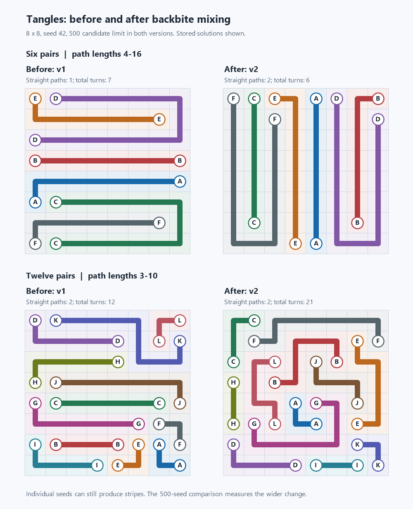

# Full-coverage generator: v1 versus v2

The v2 generator produces more varied layouts on the initial 8x8 target and
nearby board sizes. It keeps the existing no-self-touching rule and independent
solution validation. This comparison measures layout variety and generation
cost, rather than human difficulty or enjoyment.

## Implementation

`hamiltonian-path-partition-v2` changes the traversal search:

- Before the first split search, apply an unguided walk of
  `min(16384, max(256, 48 * boardCellCount))` backbite proposals: 3,072 on 8x8.
  These moves accept every valid backbite, without favouring easily split
  traversals. A one-dimensional board skips the walk.
- After 128 unsuccessful candidates, create a fresh snake with randomly chosen
  orientation and reflections, then mix it again. Restarts consume the seeded
  random stream; they do not return to the same saved traversal.
- Every eighth search proposal makes `max(2, boardCellCount / 4)` backbites
  instead of one. This helps escape plateaux in the minimum-segment score.
- Retain a found witness and explore up to `max(64, boardCellCount)` further
  candidates, replacing the previous limit of `min(32, boardCellCount)`.
- If no witness has been found, reserve up to the final 128 candidates for a
  fresh structured start. This fallback is enabled for attempt limits of at
  least 128. It preserves the ability to generate tightly constrained cases,
  although those cases can still produce stripes. It never displaces an
  already found mixed witness.

Backbites update the traversal and its inverse position map in place during
mixing. The existing induced-segment analysis, exact-count partition DP and
acceptance temperature remain in use. Every returned solution is independently
validated by the shared rules implementation.

`--max-attempts` still bounds candidate split evaluations, including refinement
and fallback. Mixing is additional bounded work. Cancellation is checked during
mixing, multi-move proposals and the existing searches.

The export records the new algorithm name. Format version 1 and the difficulty
model are unchanged; old packs remain playable. A full-coverage seed now produces
a different puzzle, so reproducing an old pack requires the old algorithm.
Connect-only generation is unchanged.

## Method

The baseline is commit `be340f55659d2e5d5237511f8c5750e409a49938`, built in
Release before editing. Each version received the same individual seeds 0..499
and the same options, with a 500-candidate limit. These are individual seed
requests, rather than the CLI's deterministically derived batch seeds.

There were nine settings, or 4,500 requests per version. All 8,027 returned
witnesses across both versions passed an additional independent checker in
the benchmark script. It checks coverage, disjointness, endpoint matching,
path lengths, adjacency and no self-touching without calling the production
validator or its adjacency helpers.

Seeds 0..99 were used while choosing the search schedule. Seeds 100..499 were
held out until the final algorithm was fixed. They confirm the same direction
of improvement: on six-pair 8x8, turns/path increase from 1.23 to 1.89 and
straight paths fall from 21.8% to 13.7%; on twelve-pair 8x8, turns/path increase
from 0.69 to 1.44 and straight paths fall from 44.3% to 14.3%.

Timing uses `Stopwatch` around `Generation.generate`, including its validation.
Grading, export and the additional checker are outside the timer. Each setting
has three warm-up calls. Versions run sequentially in separate FSI processes
using Release assemblies on the same Windows x64 machine, .NET 11.0.0.
These single-run timings are indicative; they are not a controlled performance
study. The summary JSON includes medians, p95 values and binary/source hashes.

## Results

All settings below use minimum path length 4, except twelve-pair 8x8 (3) and
two-pair 3x3 (2). Maximum length is 16, except twelve-pair 8x8 (10), ten-pair
10x10 (20), the looser 16x16 case (32), and 3x3 (7). Every row has 500 requests.

| Setting | Successes, old → new | Straight paths, old → new | Turns/path, old → new | Distinct clues, old → new | Mean ms/request, old → new |
|---|---:|---:|---:|---:|---:|
| 8x8, six pairs | 500 → 500 | 21.3% → 13.7% | 1.23 → 1.91 | 189 → 393 | 0.31 → 1.61 |
| 8x8, twelve pairs | 500 → 500 | 44.3% → 14.6% | 0.69 → 1.43 | 500 → 500 | 0.49 → 0.76 |
| 8x8, five pairs | 0 → 27 | — → 1.5% | — → 3.33 | 0 → 27 | 0.80 → 1.41 |
| 7x5, four pairs | 500 → 500 | 25.8% → 3.6% | 1.37 → 2.40 | 355 → 484 | 0.08 → 0.34 |
| 10x10, ten pairs | 500 → 500 | 38.1% → 22.8% | 0.86 → 1.65 | 500 → 500 | 0.25 → 2.70 |
| 16x16, sixteen pairs, max 16 | 500 → 500 | 80.3% → 78.9% | 0.20 → 0.21 | 14 → 14 | 0.34 → 9.70 |
| 16x16, sixteen pairs, max 32 | 500 → 500 | 40.4% → 37.4% | 0.80 → 0.92 | 500 → 500 | 0.91 → 10.37 |
| 3x3, two pairs | 500 → 500 | 18.8% → 18.9% | 1.31 → 1.31 | 12 → 12 | 0.01 → 0.08 |
| Connect-only control, 8x8, six pairs | 500 → 500 | 6.1% → 6.1% | 3.08 → 3.08 | 500 → 500 | 0.22 → 0.20 |

A straight path has zero direction changes. Turns describe the stored witness,
which need not be the only possible answer. Distinct clues ignore labels,
pair ordering and endpoint direction; rotations and reflections remain distinct.
The generator itself does not deduplicate its output.

The six-pair target has 56% more turns per path. The number of boards on which
every path has at most two turns falls from 444 to 233 out of 500. Repeated
clue layouts fall from 311 to 107. For twelve pairs, turns/path more than
double, and boards where every path has at most two turns fall from 430 to 63.

The unchanged provisional grader labels 327 of the new six-pair puzzles easy
and 173 medium, versus 497 easy and 3 medium previously. All twelve-pair
puzzles still grade easy. Those grades are uncalibrated; the new distribution
does not establish greater human difficulty.

The connect-only control is identical across all 500 seeds: clue IDs, stored
solution hashes, attempts and difficulty assessments all match the baseline.

## Examples and limits

These examples use seed 42 in both versions, rather than selecting a seed for
its appearance. The six-pair example still produces stripes and actually has
one fewer turn in v2. The twelve-pair example has more varied paths. Aggregate
improvement does not guarantee that every individual seed improves.



Load these files with the web player's **Load puzzle pack** button:

- Six pairs: [v1](examples/full-coverage-v1-seed42.json),
  [v2](examples/full-coverage-v2-seed42.json).
- Twelve pairs: [v1](examples/full-coverage-v1-twelve-pairs-seed42.json),
  [v2](examples/full-coverage-v2-twelve-pairs-seed42.json).

Five-pair 8x8 generation remains unreliable at 500 candidates: 27/500 successes
is evidence that the settings are feasible, but unsuitable for dependable
batch generation at this budget. Batch failure behaviour is unchanged.

Sixteen-pair 16x16 with maximum length 16 forces every stored path to have
exactly 16 cells. Both searches found only 14 distinct clue layouts in this
sample, and v2's extra mixing costs time without a substantial improvement.
Even allowing length 32 only gives a modest gain at this budget. Larger boards
need further work; the mixing schedule is aimed at the initial smaller boards.
The 3x3 sample also shows no gain in diversity.

There is no uniform-sampling claim, uniqueness check, solver-based difficulty
measurement or guarantee of enjoyable play. Selection and playtesting remain
separate work.

## Reproducing the comparison

From the repository root, build each version into a separate directory. Use a
separate baseline checkout at the commit above; preserve its output before
building v2. For example, in each respective checkout:

```powershell
dotnet build src/Tangles.Generator/Tangles.Generator.fsproj -c Release --disable-build-servers -o C:/Temp/Tangles-v1
# In the changed checkout, use -o C:/Temp/Tangles-v2 instead.
```

Run the current benchmark script against each pair of assemblies, in separate
processes. The script uses APIs shared by both versions:

```powershell
dotnet fsi --reference:C:/Temp/Tangles-v1/Tangles.Core.dll --reference:C:/Temp/Tangles-v1/Tangles.Generator.dll tools/benchmark-full-coverage.fsx artifacts/full-coverage-comparison/before.json 500
dotnet fsi --reference:C:/Temp/Tangles-v2/Tangles.Core.dll --reference:C:/Temp/Tangles-v2/Tangles.Generator.dll tools/benchmark-full-coverage.fsx artifacts/full-coverage-comparison/after.json 500
```

The report records per-seed success/failure, timing, attempts, shape measures,
canonical clue keys, IDs, solution hashes and grades, plus complete examples
for seeds 0 and 42. Current raw reports are in the ignored
`artifacts/full-coverage-comparison` directory. The checked-in
[summary](full-coverage-comparison-summary.json) preserves aggregate results
and the held-out subset.

Validation: all 96 .NET tests pass, including independent multi-seed checks on
thin, rectangular and larger boards, fixed-seed variety regressions, algorithm
metadata, repeatability, and candidate-budget boundaries. All four example
packs load through the shared player reader. A real 20-puzzle CLI batch loads
successfully and repeats byte-for-byte. A 64x64 search cancelled mid-run
returned after approximately 38 ms with cancellation scheduled at 25 ms.
